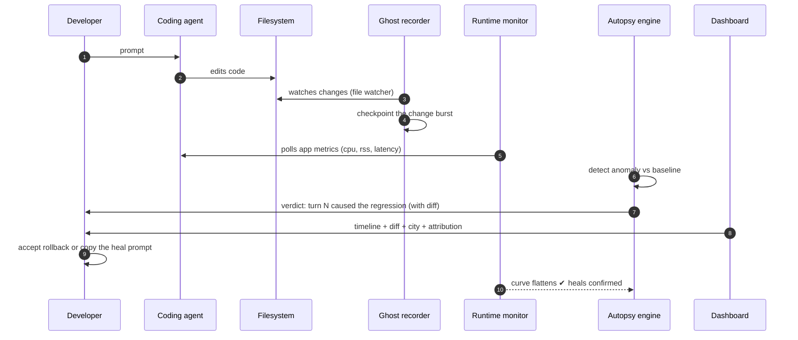
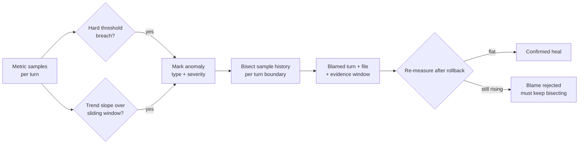
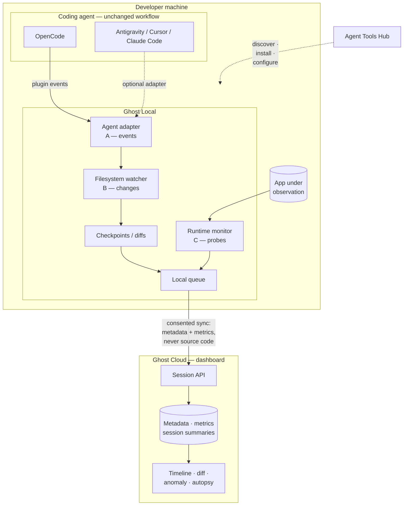
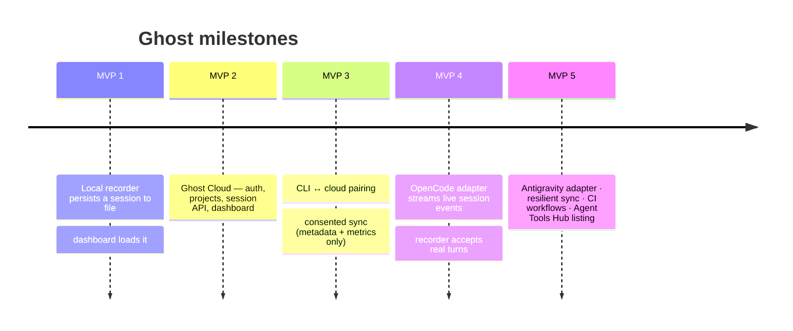

<div align="center">


# GhostInTheCodebase

**See what the AI builds. Know when it breaks it.**

*Black-box recorder and time-travel autopsy for AI coding agents.*

[](https://nextjs.org)
[](https://react.dev)
[](https://typescriptlang.org)
[](https://threejs.org)
[](https://www.testsprite.com)
[](#license-–-usage--hackathon)

**[Live demo](https://ghostinthecodebase.vercel.app) · [Playground](https://ghostinthecodebase.vercel.app/playground) · [How it works](#-how-it-works) · [Features](#-features) · [Roadmap](#-product-direction--roadmap)**

</div>

---

> 🎯 **One-liner for judges:**
> **TestSprite tells you the PR is red. Ghost tells you *which prompt* turned it red — and rolls the file back.**

Agentic coding moved the bottleneck from *writing* code to *understanding what
was written*. A diff can be green on types and still leak memory, spin the CPU,
or slow a p95 down by 400 ms. Existing tools stop at "something is broken".

| Tool | Question it answers |
| --- | --- |
| Linter / CI / types | Does it compile? |
| TestSprite | Does the PR break the app? |
| **GhostInTheCodebase** | **Which agent turn broke it — and how do I undo it?** |

Ghost is **agent-agnostic by construction**: it watches the *filesystem and the
running process*, not the agent. Cursor, Claude Code, Codex, OpenCode, or a
human typing manually — they all produce the same recording.

---

## 👤 The 60-second judge walkthrough

1. Open the **[playground](https://ghostinthecodebase.vercel.app/playground)** —
   it replays a recorded *7-turn agent session* over a demo invoice app.
2. **Scrub the tape dock** at the bottom: turn 3 adds an unbounded in-memory
   cache, turn 4 re-uses it blindly, and the app starts leaking ~38 MB per
   request.
3. Watch the **metrics chart** climb, then the **autopsy panel** opens its
   verdict: the leak is attributed to *turn 4*, naming the file that caused it.
4. Read the **AI panel**: it drafts the *heal prompt* that fixes the cache —
   copy it, paste it to your agent, and the curve flattens.
5. Every step is rendered in a **3D code city**: buildings are files, heat
   auras are runtime stress, so you *feel* the regression before you read it.

> 🔍 **Why this is honest:** the demo session is a committed fixture
> (`src/data/fixture.ts`), and every verdict is computed live by
> `src/autopsy/engine.ts` from that data — nothing is hard-coded into the UI.
> The capture path underneath is partially scaffolded and its real status is
> documented in the [status table](#-honest-status).

---

## 🧩 Features

### What works today

| # | Feature | Where | Description |
| --- | --- | --- | --- |
| 1 | 🎬 **Cinematic landing** | `app/page.tsx` | Scroll-driven product story: the loop (record → attribute → reverse), autopsy bento, the hole/Green arc of the demo API. |
| 2 | 🖥️ **Replay dashboard** | `/playground` | Tape rail + timeline dock: scrub any point of the session, see the code *and* the runtime state at that instant. |
| 3 | 🏙️ **3D code city** | `src/components/GhostCity.tsx` | three.js + react-three-fiber. Files are buildings; runtime stress draws heat auras; autopsied turns pulse red then heal green. |
| 4 | 🧠 **Autopsy engine** | `src/autopsy/engine.ts` | Anomaly detection (threshold + sliding-window trend slope) over metric samples, plus **turn attribution** — bisects the sample history to name the turn that introduced the regression. |
| 5 | 🩻 **Diff viewer** | `src/components/CodeDiff.tsx` | Line-level before/after diff for any turn, wired to the blame panel. |
| 6 | 📈 **Metrics chart** | `src/components/MetricsChart.tsx` | CPU / RSS / heap / latency timeline rendered per turn boundary. |
| 7 | 🤖 **AI panel** | `src/components/AIPanel.tsx` | Reads the autopsy verdict and drafts the next *fix prompt* for the user's agent — the "heal" half of the loop. |
| 8 | 💳 **Live target API** | `app/api/invoices/*` | A realistic invoices API the suite can poke: auth, ownership, validation. It is the application Ghost observes. |

### Plugged in, then switched on

This is the capture layer. The **contracts are defined**, the wiring to real
sources is the next milestone (see [status](#-honest-status) and
[roadmap](#-product-direction--roadmap)):

| Module | Contract | State |
| --- | --- | --- |
| `src/collector/opencode.ts` | `CollectorHandle` → stream `Turn`s from an OpenCode session | scaffold — event mapping designed (`session.diff`, `tool.execute`, `file.edited`), SSE wiring pending |
| `src/runner/metrics.ts` | `MetricSample` stream tagged with the active turn | scaffold — sampling loop pending |
| Checkpoint / rollback | commit + diff + restore per change burst | planned (shadow-git design) |

> Ghost never needs your agent account. Mode B/C below record everything from
> the outside; Mode A upgrades fidelity per agent.

---

## ⛓️ How it works

### The loop



### Autopsy internals



Anomalies detected on the demo session: **memory leak** (unbounded in-memory
cache), attributed to turn 4, severity `high`, confirmed healed at the end of
the session.

### Where Ghost sits — target architecture



The demo dashboard in this repository is the **UX of Ghost Cloud**, replaying a
session that the recorder produced. Three recording modes keep Ghost useful on
day one and progressively richer:

| Mode | Mechanism | Context |
| --- | --- | --- |
| **B** — filesystem + git | watch the worktree, checkpoint every change burst | works with *any* agent, no turn identity |
| **C** — runtime monitoring | HTTP probes + process metrics vs. measured baseline | evidence for the autopsy, not the cause by itself |
| **A** — direct agent integration | plugin/hook events for agents that support them (OpenCode plugins, hooks, SSE; Antigravity equivalents) | full session/turn identity |

**Mode B/C first; Mode A per agent.** Autopsy never fabricates a turn id: if an
agent event provides one, Ghost uses it; otherwise attribution is time-based
and *labeled as estimated*.

---

## 🧭 Product direction & roadmap

Ghost ships as **hybrid: a local recorder + a cloud dashboard.** Neither a
pure SaaS (cloud servers cannot see your filesystem, your processes, or the
app running on your laptop) nor a pure CLI (results get hard to share,
review, and onboard onto).

- **Ghost Local** runs next to the repository: filesystem watcher,
  checkpoints/shadow-git, runtime probes, agent adapters, and a local queue.
  Recording must work fully **without any cloud account** — local-only mode is
  the default.
- **Ghost Cloud** owns accounts, projects, session history and the autopsy
  view. Foundation stack: **Vercel** for the dashboard + Session API and
  **PostgreSQL** for structured metadata, metrics, and summary verdicts.
  The cloud never reads files off your machine — the local recorder is the
  only thing that observes, and it syncs deliberately.
- **Agent adapters** normalize each agent's events into **one internal event
  contract**: a plugin watches OpenCode session/file/tool events, the adapter
  translates them, and the shared recorder + autopsy engine never change per
  agent. Antigravity and others plug in later without rewriting the engine.

**Agent Tools Hub is the doorway, not the workspace** — discover Ghost, pick
your agent, read compatibility + install steps there; recording always runs
on the user's machine, next to their code.

### The user journey (target)

1. Sign in, create a project, point it at a repository → `project_id`.
2. Connect the machine: Ghost Local authenticates as a **device** via a
   one-time pairing code confirmed in the browser — the agent's account is
   never OAuth'd into Ghost.
3. Turn on an agent adapter (OpenCode first). No adapter? Modes B/C still
   record; turn identity is then marked as **estimated, never invented**.
4. Ghost takes a baseline, watches changes, probes the running app.
5. The dashboard shows timeline, diff, metrics, autopsy — **local-only by
   default**, sync is explicit opt-in.

### What syncs to the cloud — an explicit policy

| Data | Policy |
| --- | --- |
| Project name, session ids, timestamps | sync |
| Runtime metrics + probe results | sync (configurable) |
| Autopsy summaries | sync (configurable) |
| Diffs and file names | opt-in, consent-gated |
| Agent prompts / responses | opt-in — may contain secrets |
| Full source code | **never by default** |
| Tokens, API keys, secrets | **never — scrubbed before any sync** |



The recording modes and adapters are deliberately behind one **internal event
contract** (`src/types.ts`): agents vary, the engine does not.

Recording works in three layers, from always-works to richest-context:

| Mode | Mechanism | Context |
| --- | --- | --- |
| **B** — filesystem + git | watch the worktree, checkpoint every change burst | works with *any* agent, no turn identity |
| **C** — runtime monitoring | HTTP probes + process metrics vs. measured baseline | evidence for the autopsy, not the cause by itself |
| **A** — direct agent integration | plugin/hook events for agents that support them (OpenCode plugins & hooks, SSE; Antigravity equivalents) | full session/turn identity |

**Mode B/C are the base; Mode A is added per agent.** Autopsy never fabricates
a turn id: when an agent event provides one it is used; otherwise attribution
is time-based and explicitly *labeled as estimated*. Agent events (coding
activity) and runtime events (app condition) are two separate data streams —
the autopsy engine joins them only through timestamps, session identity,
checkpoints, and test evidence.

---

## 🗺️ Surfaces & API

### Web routes

| Route | Purpose |
| --- | --- |
| `/` | Landing: the loop, the city, the proof. No login needed. |
| `/playground` | The product surface: tape rail, 3D city, autopsy panel, timeline dock. |
| `/api/invoices` | Live target API exercised by the test suite. |
| `/api/invoices/[id]` | Single-invoice read — the ownership demo surface. |

### Target API contract

| Endpoint | Auth | Behavior |
| --- | --- | --- |
| `GET /api/invoices` | `x-user-id` header | Lists only the caller's invoices |
| `POST /api/invoices` | `x-user-id` header | Creates an invoice (validation enforced) |
| `GET /api/invoices/[id]` | `x-user-id` header | Owner-scoped read: `200` own · `403` cross-owner · `404` unknown |
| (any route, missing header) | — | `401` unauthenticated |

Seed data is deterministic: users `alice` and `bob`, invoice `inv-1001` owned
by `alice` — so every status code above is reproducible on demand.

### What the suite covers (test plan)

The API above is deliberately small and observable, so an end-to-end suite can
be asserted precisely:

**Suite status:** the TestSprite plan was first run red (their codegen assumed an
`invoice_id` field that the contract never declared); after refining two test
descriptions to capture `id` from the documented path, tests run green. See
`docs/test-prd.md` → *Suite maintenance log*. The PR check reruns this suite on
every push and holds the merge.


| # | Case | Expected |
| --- | --- | --- |
| 1 | Health of the target API routes | routes respond, no 500s |
| 2 | `alice` lists invoices | only alice's; never `inv-1002`'s owner data |
| 3 | `bob` lists invoices | only bob's; never `inv-1001` |
| 4 | List without header | `401`, no data leak |
| 5 | `alice` reads own invoice | `200`, seeded fields |
| 6 | **BOLA check** — `bob` reads alice's invoice | `403`, empty payload |
| 7 | Unknown id | `404 not_found` |
| 8 | Create with valid payload | `201`, currency + status defaults |
| 9 | Create missing required field | `422` |
| 10 | Create unauthenticated | `401`, nothing created |
| 11 | Autopsy on fixture run | one `leak` anomaly, severity `high` |
| 12 | Attribution | blame names the introducing turn + file |
| 13 | Heal confirmed | metric curve flattens after the fix |

Cases 11–13 run the *actual* `src/autopsy/engine.ts` against the committed
fixture — the detector must always converge on the leak, blame turn 4, and
confirm the heal. **No verdict is fabricated in this repository:** if the
engine cannot prove it, the dashboard cannot show it.

---

## ✅ Honest status

| Area | State |
| --- | --- |
| Landing page + scroll story | done |
| Playground: tape rail, timeline dock, autopsy panel | done |
| 3D code city (three.js) | done |
| Target API: invoices + ownership (`401/403/404`) | done |
| Autopsy engine: thresholds, trend, attribution, heal check | done, exercised live against the fixture |
| Metrics chart + diff viewer driven by fixture data | done |
| OpenCode collector SSE wiring | **scaffold** (contract designed) |
| Metrics runtime sampler loop | **scaffold** (contract designed) |
| Shadow-git checkpoints / one-click rollback | **planned** |
| Ghost Cloud (auth, projects, session sync) | **planned** — MVP 2 |

The dashboard today replays the committed fixture — that is the intended
scenario view. The recorder underneath is being wired in the roadmap order
above. Nothing in the UI fakes live behavior: parts that are not wired yet are
not presented as working.

---

## 🚀 Quickstart

```bash
npm install
npm run dev        # http://localhost:3000
npm run build      # production build
npm run typecheck  # tsc --noEmit
```

Deploy on Vercel with `framework: Next.js` — no environment variables required;
ownership in the demo API is enforced in code, not behind a flag.

## 🛠️ Stack

<details>
<summary><strong>Why these choices</strong> (click to expand)</summary>

| Layer | Choice | Why |
| --- | --- | --- |
| Framework | Next.js 14 (App Router) | server routes for the target API in the same process the dashboard runs in |
| UI | React 18, custom CSS tokens, Phosphor icons | full control of the cinematic look; no UI library fighting the layout |
| 3D | three.js + `@react-three/fiber` + `drei` | the code-city metaphor needs real 3D, not a canvas trick |
| Language | TypeScript strict-ish (`tsc --noEmit` gate) | the autopsy engine is logic that must not rot |
| Runtime data | committed fixture + in-memory store | deterministic demo, zero external services at runtime |

</details>

## 🧪 Testing philosophy

- **The red suite is the point.** The demo ships a hole in the API; the suite
  catches it; PR #2-fixed-style changes make it green. Enforcing ownership is
  the "green" half; the regression narrative is the "catch" half.
- The deployed dashboard replays the committed fixture, so the same demo view
  is reproducible with **no API key, no login, no network**.
- `npm run typecheck` is part of the workflow; UI work must not touch
  contracts in `app/api/*`, `src/autopsy/engine.ts`, or `src/types.ts`.

## ❓ FAQ

<details>
<summary><strong>Does Ghost replace TestSprite?</strong></summary>

No — it sits *behind* it. TestSprite answers "does the app break?" Ghost
answers "which agent prompt did it, and what is the minimal undo?".
</details>

<details>
<summary><strong>Do I need to change my agent?</strong></summary>

No. Mode B/C record from the outside — your workflow stays untouched. Mode A
adapters (OpenCode first) only *enrich* the recording with turn identity when
available.
</details>

<details>
<summary><strong>Is the demo session fake?</strong></summary>

It is a *committed, deterministic recording* (a fixture), and every verdict
shown for it is computed by the real engine at request time. Nothing is
hard-coded in the UI. The live capture path is being wired per the roadmap and
marked as such in the status table.
</details>

<details>
<summary><strong>Why in-memory store / why CPU-only metrics?</strong></summary>

Because it makes the regression *obvious and reproducible* for judges and
reviewers: a clean 38 MB-per-sample climb, blamed precisely. Production
probes (real processes, real p95) are exactly what the metrics sampler
scaffold grows into.
</details>

## 🏗️ Repository layout

```
ghostinthecodebase/
├─ app/
│  ├─ page.tsx                  # landing
│  ├─ playground/page.tsx       # playground route
│  ├─ styles/{landing,dashboard}.css
│  └─ api/invoices/             # live target API (+ [id]) 
├─ src/
│  ├─ components/               # Dashboard, AIPanel, CodeDiff, GhostCity, MetricsChart
│  │  ├─ playground/            # AutopsyPanel, SessionBar, TimelineDock, city scene
│  │  └─ site/                  # landing engine: SceneLayer, GhostCanvas, Terminal, ...
│  ├─ data/fixture.ts           # the recorded demo session
│  ├─ store/invoices.ts         # in-memory store with ownership-scoped reads
│  ├─ collector/opencode.ts     # OpenCode event adapter — scaffold
│  ├─ runner/metrics.ts         # runtime metrics sampler — scaffold
│  ├─ autopsy/engine.ts         # detection + attribution + heal check
│  └─ types.ts                  # Turn, MetricSample, Session contracts
└─ publics/ghost.png            # brand asset
```

## 🎓 Credits & meta

Built for **TestSprite Hackathon Season 4** (October 2026) — the pitch: every
other tool watches the *merge*; Ghost watches the *maker*.

- Live demo: <https://ghostinthecodebase.vercel.app>
- Playground: <https://ghostinthecodebase.vercel.app/playground>

### License — usage & hackathon

Shipped for evaluation in TestSprite Season 4. Built from scratch for this
event; reuse the *ideas*, credit the project.

<div align="center">

*Ghost stays. You code like always.*
<br/>**records · attributes · reverses**

</div>
